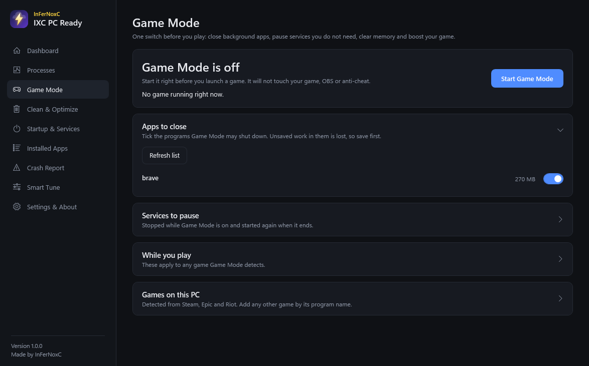

<p align="center">
  
</p>

<h1 align="center">IXC PC Ready</h1>

<p align="center">
  <b>A free performance toolkit for Windows gamers and streamers.</b><br>
  Made by <a href="https://github.com/infernoxc">InFerNoxC</a>
</p>

<p align="center">
  <a href="https://github.com/infernoxc/ixc-pc-ready/releases/latest"><b>Download the latest version</b></a>
</p>

---

IXC PC Ready reads your hardware, shows which app is using your CPU, GPU and RAM in real time, and helps you get a smoother PC for gaming and streaming. **Nothing changes until you press a button or flip a switch, and every change can be undone.**



## Install in 3 steps

There is just **one file** to download.

1. Open the [**Releases page**](https://github.com/infernoxc/ixc-pc-ready/releases/latest) and download **`IXC-PC-Ready.exe`**.
2. Double-click it and click **Yes** when Windows asks for permission.
3. Click **Yes** on the install question. A shortcut appears on your Desktop and the app opens.

From then on, just double-click **IXC PC Ready** on your Desktop. You can delete the downloaded file.

Would rather not install? Click **No** in step 3 and it runs once without installing.

**You need:** Windows 10 or 11 (64-bit). Nothing else, no extra downloads.

> **Windows says "Windows protected your PC"?** The app is new and not yet code-signed, so Windows shows this for every new unsigned program. Click **More info**, then **Run anyway**. The full source is in this repository, and each release has a `.sha256` file so you can check your download is untouched.

To remove it later: **Settings > Apps > Installed apps > IXC PC Ready > Uninstall**.

## What you get

| Page | What it does |
|---|---|
| **Dashboard** | Live CPU, GPU, RAM and disk load. Reads your hardware in detail and gives plain-English findings (mismatched RAM, monitor refresh rate not being used, no antivirus, and more). |
| **Processes** | Every running app with its own CPU, GPU, RAM and VRAM use. Games are marked. Set CPU priority and graphics preference per app. |
| **Game Mode** | One switch before you play: closes the background apps you choose, pauses services you do not need, frees memory and boosts your game. Ends by itself when the game closes and puts everything back. |
| **Clean & Optimize** | You choose what to clean: temp files, shader caches, crash dumps, update cache, Windows component store, memory. SSD TRIM for SSD and NVMe drives. |
| **Startup & Services** | Everything that starts with Windows, with an on/off switch. Protected items (security, drivers, anti-cheat) are locked. |
| **Installed Apps** | Every installed app and game, its size, and what it is using right now. |
| **Crash Report** | Reads 30 days of Windows logs and explains why apps crashed and what looks mismatched on your PC. |
| **Smart Tune** | Windows settings chosen for your hardware, with a backup of each value and one-click revert. Laptop-safe. |

More screenshots: [Dashboard](docs/screenshots/dashboard.png), [Clean & Optimize](docs/screenshots/clean.png), [Crash Report](docs/screenshots/crash-report.png), [Smart Tune](docs/screenshots/smart-tune.png).

## How to use it (first time)

1. Open **Dashboard** and read the findings. They tell you what is worth fixing on *your* PC.
2. Open **Smart Tune** and press **Apply all recommended**. You can revert at any time.
3. Open **Startup & Services** and switch off what you do not need at boot.
4. Before a gaming session, open **Game Mode**, choose which apps may be closed, and press **Start Game Mode**.

## Safety

- No account, no telemetry, no network access. Everything stays on your PC.
- Windows settings are backed up before they change and can be switched back.
- Startup items are switched off, never deleted.
- Windows Defender, Firewall, UAC, Windows Update and anti-cheat are never turned off or touched.
- It never changes your FPS cap or in-game settings.
- Game Mode never closes your game, OBS or anti-cheat, and gives paused services back when it ends.

The app asks for administrator rights because reading system data and changing services needs it.

## FAQ

**Will it make my FPS jump by a huge amount?** No tool can do that honestly. It removes background load, so you get steadier frame times and fewer stutters, mostly on PCs that are busy or misconfigured.

**Is it safe with Valorant, PUBG, Fortnite and other anti-cheat games?** Yes. It does not inject into, read the memory of, or modify any game. Anti-cheat services are locked and never touched.

**Where are my settings and backups?** In `C:\ProgramData\InFerNoxC\PC-Ready`. The *Settings & About* page has an "Open data folder" button.

**How do I start it with Windows?** *Settings & About > Start with Windows*. It is off by default.

**It found a problem I do not understand.** Open the *Crash Report* page and press *Save report*. Attach that file when you [open an issue](https://github.com/infernoxc/ixc-pc-ready/issues/new).

## Build from source

You only need Windows. The .NET Framework compiler that ships with Windows is used, so there is nothing to install.

```
powershell -ExecutionPolicy Bypass -File build\build.ps1
```

The app is built to `build\out\IXC-PC-Ready.exe`, and the single release file plus its checksum are copied to `dist\`.

## Contributing

Bug reports and ideas are welcome in [Issues](https://github.com/infernoxc/ixc-pc-ready/issues). Please include your Windows version and, if you can, the saved Crash Report.

## Licence

MIT, see [LICENSE](LICENSE). Copyright (c) 2026 InFerNoxC.
